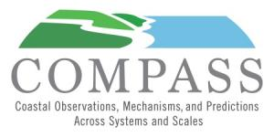

{width=450 fig-align="center"}

# About COMPASS

[The COMPASS project](https://www.pnnl.gov/projects/coastal-observations-mechanisms-and-predictions-across-systems-and-scales-compass) is funded by DOE's [Environmental System Science Program](https://ess.science.energy.gov) and aims to improve fundamental scientific understanding, model representation, and predictive capacity of coastal systems.

# COMPASS presentations at [AGU2026](https://www.agu.org/annual-meeting)

## Monday

**[NS13A-04 Linking electrical signals to soil hydraulic properties and biogeochemical state changes across coastal interfaces](https://studio.m-anage.com/agu/agu26/meetingapp.cgi/Paper/2094476)**  
14:54 - 15:06  
2018 - West (MC)  
[Efemena Destiny Emmanuel, University of Toledo](https://www.linkedin.com/in/efemena-emmanuel-0b0069129/)

## Tuesday

**[H21A-08 Salinity and Hydrology Jointly Control Biogeochemistry Across Coastal Terrestrial-Aquatic Transects in a Coupled Land Surface-Reactive Transport Model (Invited)](https://studio.m-anage.com/agu/agu26/meetingapp.cgi/Paper/2070910)**  
09:47 - 09:58  
3006 - West (MC)  
[Benjamin N Sulman, Oak Ridge National Laboratory](https://www.ornl.gov/staff/benjamin-n-sulman/)

## Wednesday

**[B34B-06 Stem moisture controls on upland tree methane and nitrous oxide fluxes observed during a four day flood experiment](https://studio.m-anage.com/agu/agu26/meetingapp.cgi/Paper/2072707)**  
17:12 - 17:23  
3011 - West (MC)  
[Nicholas Ward, Pacific Northwest National Laboratory](https://www.pnnl.gov/people/nicholas-ward)

**[NS34A-07 Continuous geophysical imaging for linking subsurface hydrology, redox dynamics and tree water use in a coastal forest critical zone](https://studio.m-anage.com/agu/agu26/meetingapp.cgi/Paper/2097723)**  
17:15 - 17:25  
2018 - West (MC)  
[Kennedy O Doro, University of Toledo](https://www.utoledo.edu/nsm/envsciences/faculty/doro.html)

## Thursday

**[B41G-2024 Going with the flow: Microbial redistribution during storms](https://studio.m-anage.com/agu/agu26/meetingapp.cgi/Paper/2096936)**  
08:30 - 12:00  
South - Poster Hall (Hall ABC) (MC)  
[Pamela Weisenhorn, Argonne National Laboratory](https://www.anl.gov/profile/pamela-weisenhorn)

**[B41Q-2298 Assessing Soil GHG Measurement Protocols for Robustness, Efficiency, and Bias](https://studio.m-anage.com/agu/agu26/meetingapp.cgi/Paper/2070678)**  
08:30 - 12:00  
South - Poster Hall (Hall ABC) (MC)  
[Ben P Bond-Lamberty, Pacific Northwest National Laboratory](https://www.pnnl.gov/people/ben-bond-lamberty)

**[B41Q-2314 Saltwater flooding increases soil anoxia by altering soil structure](https://studio.m-anage.com/agu/agu26/meetingapp.cgi/Paper/2082872)**  
08:30 - 12:00  
South - Poster Hall (Hall ABC) (MC)  
[Kenton Alan Rod, Pacific Northwest National Laboratory](https://www.pnnl.gov/people/kenton-rod)

**[B41Q-2316 Saltwater Intrusion and Sea Level Rise Consistently Suppress Decomposition but have Variable Impacts on Soil Carbon Stocks](https://studio.m-anage.com/agu/agu26/meetingapp.cgi/Paper/2080087)**  
08:30 - 12:00  
South - Poster Hall (Hall ABC) (MC)  
[Spencer Rhea, Duke University](https://nicholas.duke.edu/people/students/rhea)

**[B41Q-2324 Standardized Coastal Data for Predictive TAI Understanding: The EXCHANGE Framework](https://studio.m-anage.com/agu/agu26/meetingapp.cgi/Paper/2078551)**  
08:30 - 12:00  
South - Poster Hall (Hall ABC) (MC)  
[Kaizad F. Patel, Pacific Northwest National Laboratory](https://www.pnnl.gov/people/kaizad-patel)

**[B41Q-2326 Structural Iron (Fe) in Clay Minerals Represents a Major Fraction of the Fe Pool in Coastal Wetland Soils in the Great Lakes and Mid-Atlantic Regions](https://studio.m-anage.com/agu/agu26/meetingapp.cgi/Paper/2072143)**  
08:30 - 12:00  
South - Poster Hall (Hall ABC) (MC)  
[Edward J O'Loughlin, Argonne National Laboratory](https://www.anl.gov/profile/edward-j-oloughlin)

**[B41B-02 Wetland lateral transport along a marsh salinity gradient: impacts of biogeochemistry exceed salinity](https://studio.m-anage.com/agu/agu26/meetingapp.cgi/Paper/2093681)**  
08:40 - 08:50  
3011 - West (MC)  
[Stephanie J Wilson, Smithsonian Environmental Research Center](https://serc.si.edu/staff/wilsonsj)

**[OS42B-02 Reconstruction of nearshore water surface elevation with SWOT to force a land surface model](https://studio.m-anage.com/agu/agu26/meetingapp.cgi/Paper/2078783)**  
10:50 - 11:00  
2004 - West (MC)  
[Etienne Fluet-Chouinard, Pacific Northwest National Laboratory](https://www.pnnl.gov/people/etienne-fluet-chouinard)

**[B43E-04 Does Repeated Coastal Flooding Reshape Ecosystem Biogeochemistry?](https://studio.m-anage.com/agu/agu26/meetingapp.cgi/Paper/2083058)**  
14:47 - 14:57  
3014 - West (MC)  
[Jianqiu Zheng, Pacific Northwest National Laboratory](https://www.pnnl.gov/people/jianqiu-zheng)

## Friday

**[B51F-1700 From Flood to Flux: Stem Greenhouse Gas Responses of Coastal Trees to Flooding](https://studio.m-anage.com/agu/agu26/meetingapp.cgi/Paper/2070211)**  
08:30 - 12:00  
South - Poster Hall (Hall ABC) (MC)  
[Julianna Mullen, Ursinus College](https://www.ursinus.edu/live/profiles/11130-julianna-mullen)

**[B51L-1856 Tree mortality mechanisms in coastal forests under saltwater exposure](https://studio.m-anage.com/agu/agu26/meetingapp.cgi/Paper/2095474)**  
08:30 - 12:00
South - Poster Hall (Hall ABC) (MC)  
[Yanjun Song, Smithsonian Environmental Research Center](https://scholar.google.com/citations?user=ZjrzR2oAAAAJ&hl=en)

**[B51E-01 Using Micron-Scale Synchrotron X-ray Computed Tomography to Link Soil Pore Structure to Field-Scale Biogeochemical Processes (Invited)](https://studio.m-anage.com/agu/agu26/meetingapp.cgi/Paper/2081120)**  
08:30 - 08:40
3009 - West (MC)  
[James O'Sullivan, Argonne National Laboratory](https://www.linkedin.com/in/jbosullivan94/)

**[B51B-02 Using Soil Respiration Observations to Inform Mechanistic Modeling of the Global Carbon Cycle](https://studio.m-anage.com/agu/agu26/meetingapp.cgi/Paper/2070024)**  
08:49 - 09:07  
3012 - West (MC)  
[Ben P Bond-Lamberty, Pacific Northwest National Laboratory](https://www.pnnl.gov/people/ben-bond-lamberty)
